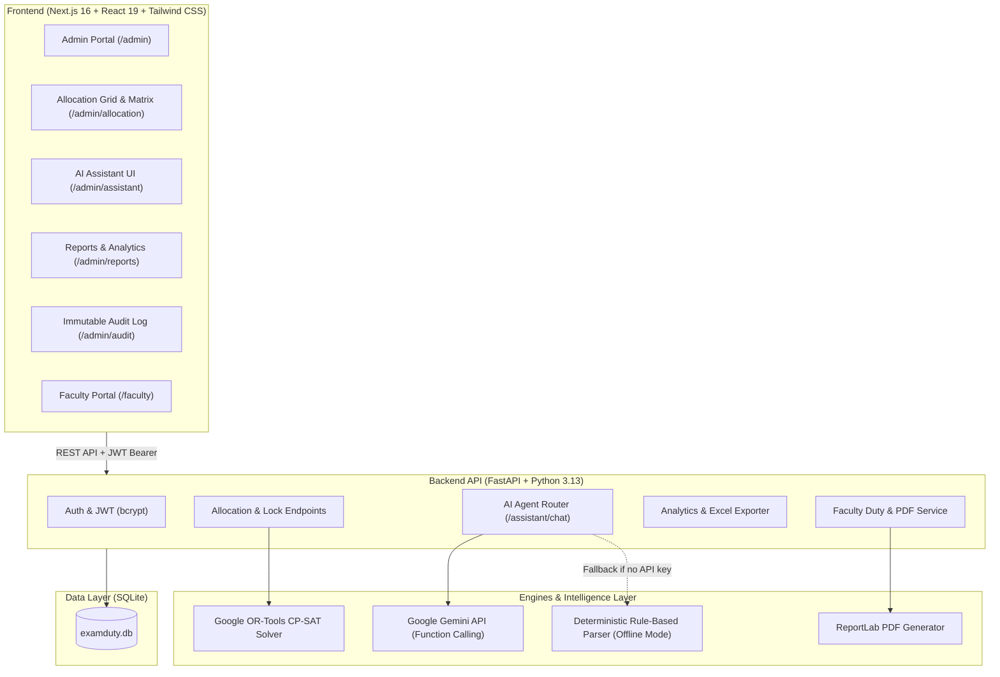

# ExamDuty AI — Intelligent Examination Management & Invigilation Allocation Agent

> **University Target:** VFSTR (Vignan's Foundation for Science, Technology & Research)  
> **Problem Track:** Automated Constraint-Based Examination Duty Scheduling & Autonomous Multi-Modal Agent Operations

**ExamDuty AI** is an enterprise-grade academic operations platform designed to solve the complex combinatorial challenge of university exam invigilation scheduling. Powered by **Google OR-Tools CP-SAT constraint programming** and an **autonomous AI Assistant (Google Gemini 2.5 with offline deterministic fallback)**, it eliminates scheduling conflicts, guarantees departmental non-bias, balances multi-semester faculty workloads, and automates last-minute leave substitutions and swap approvals.

---

## 🌟 Key Features

1. **CP-SAT Mathematical Optimization (Stage 3 & 6)**:
   - Evaluates all 7 hard institutional constraints (no double-booking, unavailability, department collision avoidance, hall capacity ratios, duty ceilings, locked assignments).
   - Minimizes workload variance via soft fairness objective ($Gini$-derived index: **95/100**).
   - Minimal-change solver (`reallocate_minimal`) that preserves fixed duties when handling replacements.

2. **Autonomous AI Assistant (`/admin/assistant`)**:
   - Natural language operations powered by Gemini function calling with deterministic rule fallback.
   - Built-in audit trail, action confirmation banners for bulk shifts, and single-click **Undo** mechanism.
   - Tool suite: `get_faculty_duties`, `list_conflicts`, `mark_faculty_unavailable`, `reallocate_minimal`, `explain_assignment`, `find_replacement`, `send_notifications`, and `get_fairness_stats`.

3. **Faculty Self-Service Portal (`/faculty`)**:
   - Next-duty hero cards, interactive duties list, and monthly calendar view.
   - **"Why did I get this duty?"** explainability button providing rule-by-rule mathematical rationales.
   - Formal institutional **PDF Duty Order Letters** generated dynamically via ReportLab.
   - Peer-to-peer **Duty Swap Requests** with automated hard constraint validation.

4. **Analytics, Compliance & Audit Trail (`/admin/reports`, `/admin/audit`)**:
   - Institutional fairness index, workload distribution charts with cohort average reference line.
   - Department-level parity breakdown and full roster export to Excel (`.xlsx`).
   - Append-only immutable SQLite audit log recording every solver run, AI tool invocation, and administrative override.

5. **Settings & Demo State (`/admin/settings`)**:
   - Configurable ratio rules, duty limits, and instructions handbook editor.
   - **"Reset Demo Data"** restores the 40-faculty, 12-hall, 25-exam canonical university dataset and drafts.

---

## 🏗️ Architecture Overview



---

## 🛠️ Tech Stack

- **Backend**: Python 3.13+, FastAPI, Google OR-Tools (CP-SAT), SQLAlchemy 2.0, SQLite with PRAGMA foreign keys, Pydantic v2, PyJWT, Bcrypt, Openpyxl, ReportLab, Google GenAI SDK.
- **Frontend**: Next.js 16 (App Router & Turbopack), React 19, TypeScript, Tailwind CSS v4, Lucide React, Sonner toasts.
- **Testing**: Pytest (23/23 tests covering hard rules, infeasible conditions, minimal reallocations, consistency, and API contracts).

---

## 🚀 Getting Started (Setup from Fresh Clone)

### Prerequisites
- **Python 3.11+** (Python 3.13 recommended)
- **Node.js 18+** or **Node.js 20+**
- **npm** or **pnpm** / **yarn**

---

### 1. Backend Setup

```bash
# 1. Navigate to the backend directory
cd backend

# 2. Create and activate a Python virtual environment
python3 -m venv venv
source venv/bin/activate       # On Windows: venv\Scripts\activate

# 3. Upgrade pip and install dependencies
pip install --upgrade pip
pip install -r requirements.txt

# 4. Set up environment variables (copy example)
cp .env.example .env

# 5. Initialize the database and seed the canonical VFSTR dataset
# (Seeds 40 faculty, 12 halls, 25 exams, and creates draft allocations)
python -m app.seed

# 6. Run the pytest test suite (verifies solver constraints and endpoints)
pytest tests/ -v

# 7. Start the FastAPI development server
uvicorn app.main:app --host 127.0.0.1 --port 8000 --reload
```

- **Backend URL**: `http://localhost:8000`
- **Interactive Swagger Docs**: `http://localhost:8000/api/docs`

---

### 2. Frontend Setup

In a new terminal window:

```bash
# 1. Navigate to the frontend directory
cd frontend

# 2. Install Node.js packages
npm install

# 3. Set up frontend environment variables
cp .env.example .env.local

# 4. Start the development server (or build for production)
npm run dev

# Alternative: production build and launch
# npm run build
# npm run start -- -p 3000
```

- **Web App URL**: `http://localhost:3000`

---

## 🐳 Docker & Render Deployment

ExamDuty AI is fully containerized and production-ready for deployment on **Render** and **Docker**. For full step-by-step documentation, see [DEPLOYMENT.md](DEPLOYMENT.md).

### Quick Docker Run (Local Compose)
Spin up both backend and frontend containers with a single command:
```bash
docker compose up --build -d
```
- **Frontend Web Portal:** `http://localhost:3000`
- **FastAPI API & Docs:** `http://localhost:8000/api/docs`
- **Health Check:** `http://localhost:8000/api/health`

### Deploy to Render (1-Click Blueprint)
1. Push this repository to your GitHub account.
2. Go to your [Render Dashboard](https://dashboard.render.com/) and click **New +** $\rightarrow$ **Blueprint**.
3. Select your `examDuty-Ai` repository. Render automatically reads `render.yaml` and sets up:
   - **`examduty-backend`** (FastAPI, CP-SAT solver, auto-seeding, health checks)
   - **`examduty-frontend`** (Next.js 16, auto-linked to backend URL)
4. Click **Apply** and your university operations platform is live!

*(For Render Free Tier single web service deployment, see the [DEPLOYMENT.md](DEPLOYMENT.md) Single Service option using the root `Dockerfile`)*

---

## ⚙️ Environment Variables

### Root / Backend `.env`
| Variable | Default Value | Description |
|---|---|---|
| `PROJECT_NAME` | `ExamDuty AI` | Application title |
| `SECRET_KEY` | `examduty-super-secret-key-vfstr-agentic-2026-secure` | JWT encryption secret |
| `DATABASE_URL` | `sqlite:///./examduty.db` | SQLite database file location |
| `GEMINI_API_KEY` | *(Optional)* | Google Gemini API Key for LLM function calling. **If omitted, the backend automatically uses its deterministic rule-based agent for 100% offline functionality.** |
| `SMTP_HOST` | `""` | *(Optional)* SMTP mail server host; falls back to server console logs if blank. |
| `SMTP_PORT` | `587` | SMTP port |
| `SMTP_USER` | `""` | SMTP username |
| `SMTP_PASSWORD` | `""` | SMTP password |

### Frontend `.env.local`
| Variable | Default Value | Description |
|---|---|---|
| `NEXT_PUBLIC_API_URL` | `http://localhost:8000/api` | Base URL of the FastAPI backend |

---

## 🔑 Demo Access Credentials

The web application login page includes **1-click quick login buttons** that pre-fill test credentials:

| Role | Email | Password | Details & Context |
|---|---|---|---|
| **Admin (Exam Cell)** | `admin@vfstr.ac.in` | `admin123` | Full access to Allocation Grid, Solver Settings, AI Assistant, Reports, Excel Export, Audit Logs, and Reset. |
| **Faculty (Medical Leave)** | `k.rao@vfstr.ac.in` | `faculty123` | **Dr. K. Rao (CSE)**: Has 1 duty assigned on 12 Nov (ideal for testing the AI leave replacement flow). |
| **Faculty (Standard)** | `p.sharma@vfstr.ac.in` | `faculty123` | **Prof. P. Sharma (ECE)**: Assigned duties, calendar view, swap requests, duty order letter download. |

---

## 🧪 Automated Test Suite

Run all 23 backend tests covering mathematical solver constraints, infeasibility detection, minimal-change reallocations, unified fairness score consistency, AI assistant tools, and reports:

```bash
cd backend
source venv/bin/activate
pytest tests/ -v
```

Expected output:
```text
tests/test_assistant.py::test_get_faculty_duties PASSED
tests/test_assistant.py::test_list_conflicts PASSED
tests/test_assistant.py::test_explain_assignment PASSED
tests/test_assistant.py::test_find_replacement PASSED
tests/test_assistant.py::test_get_fairness_stats PASSED
tests/test_assistant.py::test_demo_flow_replace_on_leave PASSED
tests/test_assistant.py::test_audit_log_populated PASSED
tests/test_assistant.py::test_fairness_score_consistency_across_screens PASSED
tests/test_solver.py::test_hard_constraint_1_every_slot_filled_by_one PASSED
tests/test_solver.py::test_hard_constraint_2_no_overlap PASSED
tests/test_solver.py::test_hard_constraint_3_respect_unavailability PASSED
tests/test_solver.py::test_hard_constraint_4_avoid_own_department PASSED
tests/test_solver.py::test_hard_constraint_5_invigilators_per_hall_capacity PASSED
tests/test_solver.py::test_hard_constraint_6_max_duties_respected PASSED
tests/test_solver.py::test_hard_constraint_7_locked_allocations_fixed PASSED
tests/test_solver.py::test_infeasible_case_shortage_detected PASSED
tests/test_solver.py::test_soft_objective_fairness_balance PASSED
tests/test_solver.py::test_minimal_change_reallocate PASSED
tests/test_stage7.py::test_admin_dashboard_endpoint PASSED
tests/test_stage7.py::test_reports_summary_endpoint PASSED
tests/test_stage7.py::test_reports_export_excel_endpoint PASSED
tests/test_stage7.py::test_audit_logs_endpoint_and_filters PASSED
tests/test_stage7.py::test_settings_and_reset_demo_flow PASSED
======================== 23 passed in ~3.8s ========================
```

---

## 📖 Demonstration Walkthrough

Refer to [DEMO_SCRIPT.md](file:///Users/priyanshukumargupta/Downloads/examDuty-Ai/DEMO_SCRIPT.md) for a step-by-step 5-minute demonstration script.
